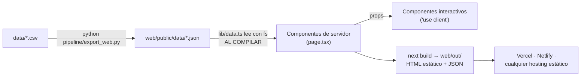
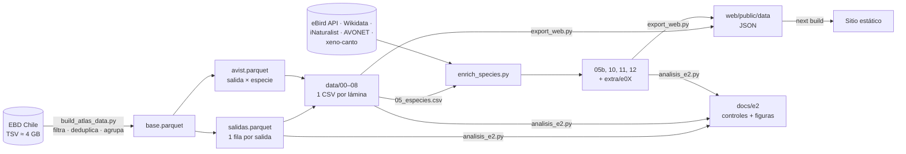
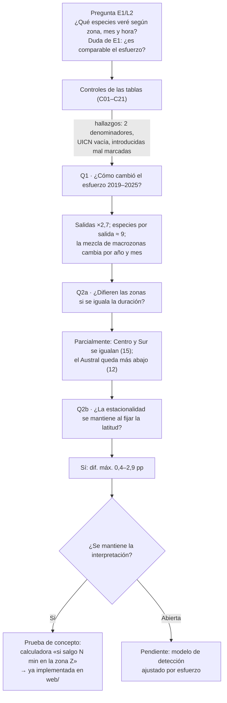
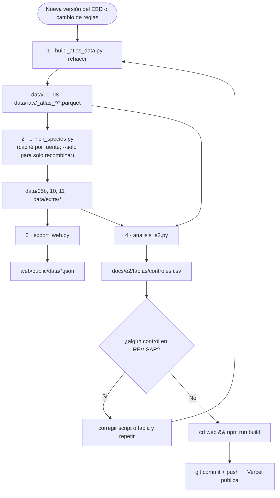

# Aves en Chile · un atlas de campo

Proyecto de **Visualización de Datos y Storytelling** (Magíster en Data Science, UDD · VIZ 2026) · **Grupo 05**
Victoria Albornoz · Matías Gebauer · Luciano Hernández · Manuel Huala · Betzabeth Torres

> *Si salgo a mirar aves, ¿cuántas especies puedo esperar, cuáles son más probables, dónde y cuándo?*

El proyecto toma **7,3 millones de registros de ciencia ciudadana de eBird (Chile, 2019–2025)** y los convierte en un atlas web para quienes practican birdwatching o disfrutan de la naturaleza. Un **pipeline en Python** limpia y agrega los datos. Un **sitio Next.js estático** los muestra. No hay backend ni base de datos.

---

## Índice

1. [Estructura del monorepo](#1-estructura-del-monorepo)
2. [Cómo se consumen los datos (sin backend)](#2-cómo-se-consumen-los-datos-sin-backend)
3. [Puesta en marcha](#3-puesta-en-marcha)
4. [Flujo de datos](#4-flujo-de-datos)
5. [Flujo lógico del análisis E2](#5-flujo-lógico-del-análisis-e2)
6. [Flujo de ejecución del código](#6-flujo-de-ejecución-del-código)
7. [Idea clave: contar salidas](#7-idea-clave-contar-salidas)
8. [Cifras de control](#8-cifras-de-control)
9. [Tablas y relaciones](#9-tablas-y-relaciones)
10. [Sitio web: páginas y láminas](#10-sitio-web-páginas-y-láminas)
    - [10b. Sitios KBA y rangos BirdLife](#10b-sitios-kba-y-rangos-birdlife-pestaña-lugares)
11. [Sistema visual](#11-sistema-visual)
12. [Calidad: controles y problemas abiertos](#12-calidad-controles-y-problemas-abiertos)
13. [Limitaciones](#13-limitaciones)
14. [Fuentes, licencias y uso de IA](#14-fuentes-licencias-y-uso-de-ia)

---

## 1. Estructura del monorepo

```
aves-chile-atlas/
├── pipeline/                       # Python: del EBD a tablas y JSON
│   ├── build_atlas_data.py         # paso 1 · TSV → parquet → CSV por lámina
│   ├── enrich_species.py           # paso 2 · cruces con eBird API, Wikidata, iNaturalist, AVONET, xeno-canto
│   ├── export_web.py               # paso 3 · CSV → JSON para el sitio (solo biblioteca estándar)
│   ├── aves_sonidos.py             # utilidad: descarga de grabaciones de xeno-canto
│   ├── analisis/
│   │   ├── analisis_e2.py          # controles C01–C21, exploración y prueba de concepto (E2)
│   │   └── eda_ebird.py            # EDA inicial (marimo)
│   ├── legacy/export_viz_data.py   # versión anterior del export, solo referencia
│   └── requirements.txt
│
├── data/                           # tablas agregadas (versionadas, ~7 MB)
│   ├── 00_kpis.csv … 11_rasgos.csv
│   ├── extra/                      # e01–e05, 12_sonidos, pendientes_estatus
│   └── raw/                        # NO versionado: EBD, AVONET, parquet (ver raw/LEEME.md)
│
├── web/                            # Next.js (App Router, export estático)
│   ├── public/data/                # JSON generados por export_web.py (versionados, ~2,6 MB)
│   ├── lib/data.ts                 # ÚNICO lugar que lee y tipa los datos
│   ├── app/                        # páginas: / · /estadisticas · /especies · /especies/[slug] · /calculadora
│   ├── components/                 # Hero, MapaMacrozonas, Calculadora… y laminas/ (una por lámina)
│   └── scripts/build-chile.mjs     # mapa de macrozonas (BCN) → lib/chile-geo.json
│
└── docs/
    ├── README_tecnico.md           # diccionario de campos y reglas detalladas
    ├── e2/tablas · e2/figuras      # salidas de analisis_e2.py
    └── entregas/                   # E1, L1, L2, brief E2, rúbricas
```

---

## 2. Cómo se consumen los datos (sin backend)

**El sitio no necesita servidor, API ni SQLite.** Los datos cambian solo cuando se vuelve a correr el pipeline, y lo que el sitio muestra ya viene agregado: ~7 MB en CSV y ~2,6 MB en JSON.



- `lib/data.ts` lee los JSON con `fs` **durante `next build`**. Cada página sale como HTML ya armado, incluida una por especie (566 páginas generadas con `generateStaticParams`).
- Lo interactivo (calculadora, buscador) recibe los datos como **props** desde la página del servidor. No hay `fetch` ni backend.
- **Contrato de datos:** los tipos de `lib/data.ts` deben coincidir con lo que escribe `export_web.py`. Si se cambia un campo, se cambia en los dos.
- Si algún día se necesitan consultas libres sobre los 4,8 M de avistamientos, la opción sin backend es **DuckDB-WASM** leyendo un parquet en el navegador. Hoy no hace falta.

---

## 3. Puesta en marcha

### Solo el sitio (lo más común)

Los JSON ya están versionados, así que basta con Node ≥ 20:

```bash
cd web
npm install
npm run dev          # http://localhost:3000
npm run build        # genera web/out/ (sitio estático)
```

**Publicar:** importar el repo en Vercel con *Root Directory* = `web`. Con `output: "export"`, Vercel sirve `out/` sin configuración extra. Funciona con repositorios privados en el plan gratuito.

### Regenerar los datos

```bash
python -m venv .venv && .venv\Scripts\activate        # Windows (macOS/Linux: source .venv/bin/activate)
pip install -r pipeline/requirements.txt
# o, sin instalar nada:  uv run --with-requirements pipeline/requirements.txt python ...

# 1. limpieza y CSV por lámina (necesita data/raw/chile_ebd_relSep-2026.txt)
python pipeline/build_atlas_data.py --tsv data/raw/chile_ebd_relSep-2026.txt --out data
# 2. cruces externos (claves en .env; caché en data/extra/cache)
python pipeline/enrich_species.py --data data --tmp data/raw/_atlas_2019_2025 \
       --avonet "data/raw/AVONET Supplementary dataset 1.xlsx"
#    solo recombinar, sin consultar APIs:  python pipeline/build_uicn.py                                      # UICN → data/extra/e04_iucn.csv (descarga manual en data/UICN)
python pipeline/enrich_species.py --data data --solo
# 3. JSON para el sitio
python pipeline/export_web.py
# 3b. sitios KBA (opcional; necesita data/KBA_Data y data/raw/_atlas_2019_2025/*.parquet, ver §10b)
python pipeline/build_kba.py
python pipeline/export_web.py      # vuelve a correr para generar web/public/data/kba.json
# 4. controles y figuras E2 (necesita data/raw/_atlas_2019_2025/salidas.parquet)
python pipeline/analisis/analisis_e2.py
```

En Windows conviene ejecutar `set PYTHONUTF8=1` antes, para evitar errores de codificación con nombres de especies.

---

## 4. Flujo de datos



---

## 5. Flujo lógico del análisis E2



---

## 6. Flujo de ejecución del código



---

## 7. Idea clave: contar salidas

| Término | Definición |
|---|---|
| **Salida** | Una persona o grupo observando en un lugar y un tiempo. Si una lista se compartió entre varios observadores, el EBD la repite una vez por persona; aquí cuenta **una**. |
| **Avistamiento** | Una especie dentro de una salida: diez chincoles en la misma salida son un avistamiento. |
| **Individuos** | Conteo del avistamiento. Puede ser `X` (presente sin contar); **no es abundancia**. |
| **Salida completa** | `ALL SPECIES REPORTED = 1`. Solo en estas salidas la ausencia de una especie es informativa. |

**Indicador principal: % de salidas con avistamiento** = salidas en que se vio la especie ÷ total de salidas. En el sitio se comunica como «en 1 de cada 3 salidas».

> ⚠ Hay dos denominadores con el mismo nombre de columna. `05_especies.pct_salidas` divide por *todas* las salidas; `02_ridge`, `03_fenologia` y `08_nodos` dividen por salidas *completas* (control C07, pendiente).

---

## 8. Cifras de control

EBD `relSep-2026`, 2019–2025 (`data/00_kpis.csv`):

| Métrica | Valor |
|---|---|
| Filas válidas del EBD | 7.327.275 |
| Listas eBird → **salidas** | 744.047 → **524.381** |
| Salidas completas | 407.397 (77,7 %) |
| **Avistamientos** (salida × especie) | **4.851.059** |
| Especies | **566** (567 en las tablas, que incluyen un nombre «sp.») |
| Observadores · localidades | 14.876 · 142.423 |
| Salidas 2019 → 2025 | 41.968 → 111.926 (×2,7) |

---

## 9. Tablas y relaciones

Las tablas de hechos agregados **no se unen entre sí**: comparten columnas de agrupación (`macrozona`, `month`, `year`). La única unión real es por **`sci_name`**, una fila por especie en `05`, `05b`, `10`, `11`, `12` y `e0X` (control C04).

| Tabla | Una fila es… | Claves |
|---|---|---|
| `salidas.parquet` (raw) | una salida | `salida_id` |
| `00_kpis` · `00_anual` · `00_regiones` | resumen · año · región | `year` · `region_code` |
| `01_hex` | celda de 0,25° | `celda` |
| `02_ridge` | especie × mes × franja de 0,5° | `sci_name`, `month`, `lat_banda` |
| `03_fenologia` | especie × mes | `sci_name`, `month` |
| `04_reloj` · `04_sol` | macrozona × mes × hora | `macrozona`, `month` |
| `05_especies` · `05b_especies_enriquecidas` | una especie | `sci_name` |
| `06_acumulacion` · `06_probabilidad` | macrozona × duración (× especie) | `macrozona`, `minutos`, `sci_name` |
| `07_marea` | año × mes × macrozona | `year`, `month`, `macrozona` |
| `08_nodos` · `08_aristas` | especie (top 40) · par | `sci_name` · `source`, `target` |
| `13_kba_sitios` · `13_kba_proteccion` | sitio KBA (≥ 1 salida) · tramo de protección | `kba_id` · `tramo` |
| `13_kba_especies` | sitio KBA × especie | `kba_id`, `sci_name` |
| `10_riesgo` · `11_rasgos` · `extra/12_sonidos` · `extra/e0X` | una especie | `sci_name` |

Diccionario campo por campo: [`docs/README_tecnico.md`](docs/README_tecnico.md) §8.

---

## 10. Sitio web: páginas y láminas

**Implementado (v0.3):** tres pestañas, cada lámina de L2 en la que mejor responde a su pregunta.

| Ruta | Pestaña | Láminas (interactivas) | Datos |
|---|---|---|---|
| `/` | Portada | «¿Qué buscas hoy?» (Especie · Lugar · Estadísticas), cifras, salidas por año, mapa de macrozonas | `resumen`, `calculadora`, `marea` |
| `/estadisticas` | **Estadísticas**: el país en conjunto | 7 Marea (streamgraph) · 1 Mapa bivariado · 8 Red de co-ocurrencia · 11 Espacio de rasgos | `marea`, `laminas/mapa`, `laminas/red`, `laminas/rasgos` |
| `/especies` | **Especies**: una por una | Catálogo · 5 Enjambre de rareza · 9 Riesgo vs. visibilidad · 10 Oído vs. vista (con audio) · 2 La ola | `especies`, `laminas/especies`, `laminas/oido`, `laminas/ola` |
| `/especies/[slug]` | Ficha | Foto, canto, fenología mensual, **su propia ola** (lámina 2), rasgos | `especies/<slug>.json` |
| `/calculadora` | **Tu salida**: planear una salida | 6 Calculadora (con mapa de macrozonas, acepta `?zona=`) · 3 Rueda «qué buscar este mes» · 4 Reloj «a qué hora» | `calculadora`, `laminas/rueda`, `laminas/reloj` |

- Cada lámina lleva sus tres notas (Cómo leer · Hallazgo · Limitación); las cifras de los hallazgos se calculan desde los JSON al compilar.
- Librerías: **d3** (escalas, `d3-shape`, `d3-force`, `d3.stack`) dentro de componentes React, y **motion** para la UI. Respecto del plan de L2: el mapa bivariado se dibuja en SVG sobre el contorno de la BCN (sin deck.gl ni teselas), la red usa d3-force (no sigma.js) y los rasgos van en SVG (no Observable Plot), para no sumar dependencias pesadas a un sitio estático.
- `export_web.py` escribe `web/public/data/laminas/*.json` (función `exportar_laminas`) y agrega `ola` a cada ficha. Los tipos están en `web/lib/laminas-datos.ts`.
- El mapa de macrozonas (`lib/chile-geo.json`) une las regiones de la BCN según `MACRO` de `build_atlas_data.py`; se regenera con `npm run geo`.

**Pendiente:** hexágonos H3 para el mapa, tendencia UICN (token), validar el denominador de salidas completas (C07).

| `/lugares` | **Lugares**: dónde ir | Sitios KBA cerca de ti (geolocalización solo en el navegador o por macrozona), qué aves esperar, mejor mes; tabla de protección | `kba` |

Orden narrativo sugerido: 7 → 1 → 2, 3, 4 → 5, 9 → 8 → 10 → 11 → 6 (tu salida).

---

## 10b. Sitios KBA y rangos BirdLife (pestaña «Lugares»)

Cruza las salidas de eBird con las **Áreas Clave para la Biodiversidad (KBA)** de Chile (188 sitios) para recomendar lugares y decir qué aves esperar en ellos.

```bash
python pipeline/build_kba.py                  # KBA × eBird → data/13_kba_*.csv (+ data/kba_privado/, no se versiona)
python pipeline/extraer_rangos_chile.py       # (una vez) recorta los rangos BirdLife del GeoPackage mundial a Chile
python pipeline/build_rangos.py               # rango BirdLife por especie → data/extra/e06_birdlife.csv
python pipeline/fuera_de_rango.py             # % de salidas fuera del rango → data/extra/e07_fuera_rango.csv
python pipeline/export_web.py                 # → web/public/data/kba.json
```

Entradas (no se versionan; ver `.gitignore`): `data/KBA_Data/` (shapefiles, `KBA-Sites.csv`, especies gatillo) y `data/species_data/` (BOTW 2025 GeoPackage, checklist HBW/BirdLife v10). Dependencias: `geopandas`, `pyogrio`, `shapely`, `pyarrow`.

**Cómo se relaciona una salida con un sitio:** `dentro` si la localidad cae estrictamente en el polígono; `cerca` si está a ≤ 0,02° (~2 km). Los indicadores públicos usan solo `dentro`. Los sitios puntuales se amplían con un buffer según su superficie reportada.

| Tabla | Una fila es… | Campos principales |
|---|---|---|
| `13_kba_sitios` | un sitio KBA | `kba_id`, `nombre`, `salidas_dentro/cerca`, `localidades`, `salidas_completas`, `riqueza_mediana/p90` (solo con ≥ 20 salidas completas), `salidas_2019..2025`, `mes_01..12`, `punto_lat/lon/salidas/publicable`, `especies`, `n_gatillo_aves`, `gatillo_vistas`, `pct_gatillo_vistas` |
| `15_nidificacion` | una especie nidificante (atlas) | `sci_name` |
| `13_kba_especies` | sitio × especie | `kba_id`, `sci_name`, `salidas_con`, `pct_completas` (salidas completas con la especie ÷ salidas completas del sitio), `mes_pico` |
| `13_kba_proteccion` | tramo de superficie protegida | `tramo` (0 %, 1–50 %, 51–99 %, 100 %), `sitios`, `salidas_dentro`, `pct_salidas_en_kba` |
| `e06_birdlife` | una especie | presencia en rango BirdLife, estatus de rango en Chile, categoría UICN 2025 (privada) |
| `e07_fuera_rango` | una especie | % de salidas a > 10/25/50 km de su rango (privada) |

**Punto de cada sitio:** nunca sale de la capa KBA. Es la celda de 0,01° con más salidas dentro del sitio y se publica (redondeada a 2 decimales) solo si hay ≥ 2 localidades y ≥ 20 salidas en la celda: 100 de 127 sitios con datos. Los demás se muestran por macrozona.

**Hallazgos de control:** 16,9 % de las salidas caen dentro de algún KBA; los 91 sitios sin protección (0 %) reciben 23,4 % de las salidas en KBA; las aves gatillo se ven en ~80 % de los casos; 18 sitios no tienen ninguna salida.

**Términos de uso (importante):**
- La capa KBA no se redistribuye: el repositorio y el sitio solo contienen indicadores derivados de eBird y la cita obligatoria (pie del sitio y `kba.json`). Se pidió el acceso a KBA con ese propósito; **la consulta al Secretariado KBA sobre publicar puntos y derivados está pendiente**.
- Los rangos BirdLife se solicitaron para «mapas de 1–10 especies» y «análisis académico»: `e06`/`e07` están en `.gitignore` y **no se usan en el sitio** hasta tener respuesta de BirdLife.
- Cita KBA: BirdLife International (2026). *Digital boundaries of Key Biodiversity Areas from the World Database of KBAs*. KBA Partnership. https://www.keybiodiversityareas.org (descargado el 14/11/2026).

**Limitaciones:** los rangos BirdLife tienen bordes gruesos (p. ej. ~30 km tierra adentro), por eso «fuera de rango» solo es fiable en umbrales altos (≥ 90 %: 36 especies); 3 nombres sin correspondencia (*Eulidia yarrellii*, *Ochetorhynchus andaecola*, *Procelsterna cerulea*) y algunos cruces por sinónimo marcados «revisar» en `data/extra/overrides_birdlife.csv`; una salida en dos KBA superpuestos cuenta en ambos; no se encontró el archivo de series de índices de riesgo por especie en `KBA_Data`.

### Atlas de nidificación (Medrano et al. 2018)

`python pipeline/build_nidificacion.py` cruza `data/extra/atlas_nidificacion_v3.csv` con `03_fenologia` y escribe `data/15_nidificacion.csv` (316 especies, todas con `sci_name` ya en la taxonomía de eBird; `sci_atlas` guarda el nombre del atlas).

| Campo | Significado |
|---|---|
| `resumen` | resumen propio (no copia el atlas) de 2–3 líneas |
| `altitud_min/max` | rango de altitud de nidificación (m s. n. m.) |
| `meses_nidificacion` | meses (1–12) con nidificación; vacío si la ficha requiere revisión |
| `pico_ebird`, `coincide_pico`, `razon_temporada` | mes de máximo en eBird; si cae dentro de la temporada; % medio dentro ÷ fuera |
| `revisar`, `nota` | 60 fichas con datos incompletos o por confirmar |

**Resultado:** el mes de mayor registro en eBird cae dentro de la temporada de nidificación en 99 de 242 especies (41 %), poco más que lo esperable por azar (34 %): lo más visible no coincide, en general, con el período reproductivo. Se muestra en cada ficha (franja dorada bajo la fenología y un bloque «Nidificación en Chile»).

**Límites:** el atlas es de 2011–2016 y eBird de 2019–2025, y se muestran como fuentes separadas; los meses salen de frases del texto y pueden incluir cuidado de polluelos; solo se publica el resumen propio con la cita de Medrano et al. (2018), *Atlas de las aves nidificantes de Chile*, ROC. El PDF está en `raw_data/07_referencias/`.

---

## 11. Sistema visual

Fuente: el sistema de diseño «Atlas de aves en Chile» (artifact en claude.ai). Los tokens viven en `web/app/tokens.css` (generado desde su `tokens.json`) y los estilos en `web/app/globals.css`. El tema se elige con el selector Día/Noche de la cabecera (se guarda en el navegador); por defecto sigue al sistema.

| Token | Día de campo | Noche de campo |
|---|---|---|
| `fondo` / `superficie` | `#E9E7DC` / `#F4F2EA` | `#161913` / `#1F231B` |
| `texto` / `texto-suave` | `#22261C` / `#595D4E` | `#E7E4D4` / `#A9AA99` |
| `foco` (conchovino) · `sol` (barro) | `#7A2638` · `#8C6418` | `#D46A79` · `#E2AE45` |
| Categórica `cat-musgo … cat-ciruela` | `#667B26 #00789E #93303F #A9781E #6E4A86` | `#86993C #1A99AA #C85A6B #BD8726 #9A6FBF` |
| Secuenciales | `musgo-1…6` (cantidad), `conchovino-1…6` (intensidad) | ídem, más valor = más claro |

- Tipografía (Google Fonts, servidas localmente con Fontsource): **Fraunces** con `SOFT 100, WONK 1` (títulos y nombres de especie), **Hanken Grotesk** (texto) y **DM Mono** (cifras y etiquetas).
- Logo: la «pluma de datos» (`web/public/brand/`), una pluma cuyas barbas son celdas de 0,25°.
- Reglas: barras desde cero, un solo foco por vista, la categórica siempre en el mismo orden y **una sola dimensión por vista** (hábitat **o** macrozona), y cada vista con fuente, unidad y n. Todo gráfico lleva tres notas: Cómo leer, Hallazgo, Limitación.

---

## 12. Calidad: controles y problemas abiertos

`pipeline/analisis/analisis_e2.py` ejecuta 21 controles (esperado vs. observado) → `docs/e2/tablas/controles.csv`.

| ID | Estado | Detalle |
|---|---|---|
| C09 | ✅ corregido (nov-2026) | `uicn` estaba vacía: Wikidata entrega etiquetas en español («especie vulnerable»). Se amplió `WD_IUCN` en `enrich_species.py` → 525 especies con categoría; con la descarga UICN (`build_uicn.py`) sube a 556. |
| C10 | ✅ corregido (nov-2026) | La regla de introducidas era «exótico **o** iNat introducida»; ahora es la documentada: «código exótico **y** iNaturalist no la considera nativa ni endémica». Tiuque, Diuca y Cachaña vuelven a nativas → 41 introducidas. |
| C11 | ✅ resuelto | Cifra pública: 566 especies (`export_web.py` excluye el nombre «sp.»). |
| C16–C21 | ✅ OK (nov-2026) | Suma mensual por sitio KBA, puntos con ≥ 20 salidas, sin geometría en `kba.json`, 3 aves gatillo sin equivalente en eBird (*Eulidia yarrellii* es especie sensible, excluida del EBD; *Ochetorhynchus andaecola* y *Procelsterna cerulea* sin registros), UICN descargada = Wikidata (0 discrepancias), atlas sin meses en fichas por revisar. |
| C07 | ⏳ pendiente | `pct_salidas` con dos denominadores; renombrar a `pct_salidas_completas` en 02, 03, 06 y 08. |

C16–C21 (KBA, UICN y atlas de nidificación) dan OK. El brief E2 (`docs/entregas/Brief_E2_…docx`) ya refleja estos controles y las figuras regeneradas.

---

## 13. Limitaciones

- **Registros ≠ abundancia.** Todo indicador mide detección por observadores.
- **Esfuerzo desigual:** 10 celdas de 0,25° concentran el 35 % de las salidas.
- **Especies sensibles:** eBird excluye del EBD al Picaflor de Arica.
- **Calculadora:** excluye Norte Grande ≥ 180 min (1.655 salidas con una sola especie, probable monitoreo de una especie).
- **UICN** global vía Wikidata (sin tendencia ni RCE nacional).
- **Fotos de iNaturalist:** muchas son CC BY-NC; el sitio es académico y no comercial, y muestra siempre el crédito.
- **KBA/BirdLife:** ver §10b (términos, puntos derivados de eBird, rangos solo para análisis interno).
- **Privacidad:** el repositorio es privado. `salidas.parquet` no se versiona.

---

## 14. Fuentes, licencias y uso de IA

- **eBird Basic Dataset** EBD_relSep-2026. Cornell Lab of Ornithology. Términos de uso de eBird.
- **AVONET** — Tobias, J. A. et al. (2022). *Ecology Letters*, 25, 581–597. CC BY 4.0.
- **Cartografía:** Biblioteca del Congreso Nacional (BCN), mapas vectoriales, vía el paquete `react-chile-map` (MIT). Referencial.
- **KBA World Database** (sep-2026) — BirdLife International y KBA Partnership, uso bajo los términos del Secretariado KBA (ver §10b). **BirdLife/HBW** (BOTW 2025, checklist v10) — uso interno de análisis; sin redistribución.
- **UICN Red List** (descarga CSV, evaluaciones globales hasta 2026; `pipeline/build_uicn.py` → `data/extra/e04_iucn.csv`). Términos v3: la categoría es de uso libre; el resto de los datos no se redistribuye, por eso `data/UICN/` y `e04` no se versionan y el sitio publica solo la categoría. La tendencia solo se muestra como total por categoría (Especies, lámina 9). Citar con la versión descargada: IUCN (año y versión: copiar la cita exacta que entrega la descarga). *The IUCN Red List of Threatened Species*. https://www.iucnredlist.org (descargado el 14/11/2026).
- **Atlas de las aves nidificantes de Chile** — Medrano, F. et al. (2018). Red de Observadores de Aves y Vida Silvestre de Chile, Santiago. Solo resúmenes propios, con cita (ver §10b).
- **Wikidata** (CC0) · **iNaturalist** y **xeno-canto** (cada foto y grabación con su autor y licencia) · **UICN**.
- **Uso de IA:** Claude (Anthropic) reordenó el repositorio y escribió `export_web.py`, el módulo KBA/BirdLife (`build_kba.py`, `build_rangos.py`, `fuera_de_rango.py`, pestaña «Lugares»), `analisis_e2.py`, el sitio Next.js inicial y esta documentación; también corrigió C09 y C10 en `enrich_species.py`. La revisión final es del equipo.
