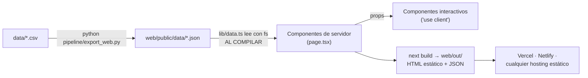
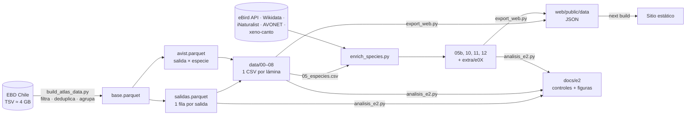
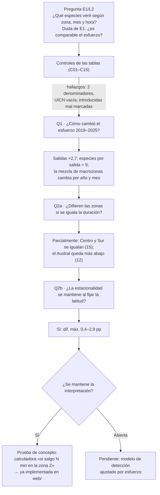
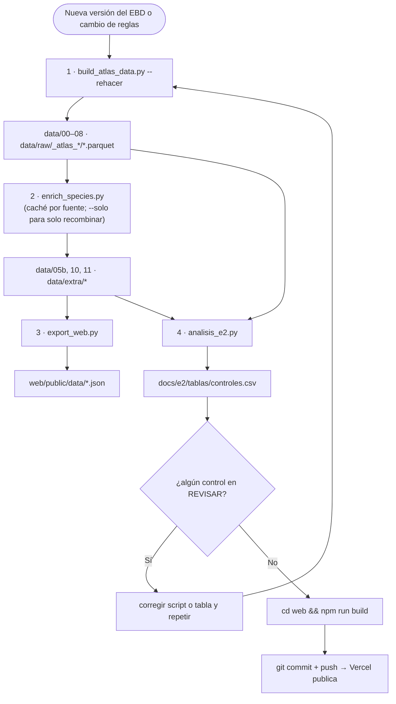

# Aves en Chile · un atlas de campo

Proyecto de **Visualización de Datos y Storytelling** (Magíster en Data Science, UDD · VIZ 2026) · **Grupo 05**
Victoria Albornoz · Matías Gebauer · Luciano Hernández · Manuel Huala · Betzabeth Torres

> *Si salgo a mirar aves, ¿cuántas especies puedo esperar, cuáles son más probables, dónde y cuándo?*

El proyecto toma **7,3 millones de registros de ciencia ciudadana de eBird (Chile, 2019–2025)** y los convierte en un atlas web para quienes practican birdwatching o disfrutan de la naturaleza. Un **pipeline en Python** limpia y agrega los datos. Un **sitio Next.js estático** los muestra. No hay backend ni base de datos.

---

## Índice

1. [Estructura del monorepo](#1-estructura-del-monorepo)
2. [Cómo se consumen los datos (sin backend)](#2-cómo-se-consumen-los-datos-sin-backend)
3. [Puesta en marcha](#3-puesta-en-marcha)
4. [Flujo de datos](#4-flujo-de-datos)
5. [Flujo lógico del análisis E2](#5-flujo-lógico-del-análisis-e2)
6. [Flujo de ejecución del código](#6-flujo-de-ejecución-del-código)
7. [Idea clave: contar salidas](#7-idea-clave-contar-salidas)
8. [Cifras de control](#8-cifras-de-control)
9. [Tablas y relaciones](#9-tablas-y-relaciones)
10. [Sitio web: páginas y láminas](#10-sitio-web-páginas-y-láminas)
11. [Sistema visual](#11-sistema-visual)
12. [Calidad: controles y problemas abiertos](#12-calidad-controles-y-problemas-abiertos)
13. [Limitaciones](#13-limitaciones)
14. [Fuentes, licencias y uso de IA](#14-fuentes-licencias-y-uso-de-ia)

---

## 1. Estructura del monorepo

```
aves-chile-atlas/
├── pipeline/                       # Python: del EBD a tablas y JSON
│   ├── build_atlas_data.py         # paso 1 · TSV → parquet → CSV por lámina
│   ├── enrich_species.py           # paso 2 · cruces con eBird API, Wikidata, iNaturalist, AVONET, xeno-canto
│   ├── export_web.py               # paso 3 · CSV → JSON para el sitio (solo biblioteca estándar)
│   ├── aves_sonidos.py             # utilidad: descarga de grabaciones de xeno-canto
│   ├── analisis/
│   │   ├── analisis_e2.py          # controles C01–C15, exploración y prueba de concepto (E2)
│   │   └── eda_ebird.py            # EDA inicial (marimo)
│   ├── legacy/export_viz_data.py   # versión anterior del export, solo referencia
│   └── requirements.txt
│
├── data/                           # tablas agregadas (versionadas, ~7 MB)
│   ├── 00_kpis.csv … 11_rasgos.csv
│   ├── extra/                      # e01–e05, 12_sonidos, pendientes_estatus
│   └── raw/                        # NO versionado: EBD, AVONET, parquet (ver raw/LEEME.md)
│
├── web/                            # Next.js (App Router, export estático)
│   ├── public/data/                # JSON generados por export_web.py (versionados, ~2,6 MB)
│   ├── lib/data.ts                 # ÚNICO lugar que lee y tipa los datos
│   ├── app/                        # páginas: / · /calculadora · /especies · /especies/[slug] · /datos
│   ├── components/                 # Hero, MapaMacrozonas, Calculadora, BuscadorEspecies, Fenologia…
│   └── scripts/build-chile.mjs     # mapa de macrozonas (BCN) → lib/chile-geo.json
│
└── docs/
    ├── README_tecnico.md           # diccionario de campos y reglas detalladas
    ├── e2/tablas · e2/figuras      # salidas de analisis_e2.py
    └── entregas/                   # E1, L1, L2, brief E2, rúbricas
```

---

## 2. Cómo se consumen los datos (sin backend)

**El sitio no necesita servidor, API ni SQLite.** Los datos cambian solo cuando se vuelve a correr el pipeline, y lo que el sitio muestra ya viene agregado: ~7 MB en CSV y ~2,6 MB en JSON.



- `lib/data.ts` lee los JSON con `fs` **durante `next build`**. Cada página sale como HTML ya armado, incluida una por especie (566 páginas generadas con `generateStaticParams`).
- Lo interactivo (calculadora, buscador) recibe los datos como **props** desde la página del servidor. No hay `fetch` ni backend.
- **Contrato de datos:** los tipos de `lib/data.ts` deben coincidir con lo que escribe `export_web.py`. Si se cambia un campo, se cambia en los dos.
- Si algún día se necesitan consultas libres sobre los 4,8 M de avistamientos, la opción sin backend es **DuckDB-WASM** leyendo un parquet en el navegador. Hoy no hace falta.

---

## 3. Puesta en marcha

### Solo el sitio (lo más común)

Los JSON ya están versionados, así que basta con Node ≥ 20:

```bash
cd web
npm install
npm run dev          # http://localhost:3000
npm run build        # genera web/out/ (sitio estático)
```

**Publicar:** importar el repo en Vercel con *Root Directory* = `web`. Con `output: "export"`, Vercel sirve `out/` sin configuración extra. Funciona con repositorios privados en el plan gratuito.

### Regenerar los datos

```bash
python -m venv .venv && .venv\Scripts\activate        # Windows (macOS/Linux: source .venv/bin/activate)
pip install -r pipeline/requirements.txt
# o, sin instalar nada:  uv run --with-requirements pipeline/requirements.txt python ...

# 1. limpieza y CSV por lámina (necesita data/raw/chile_ebd_relSep-2026.txt)
python pipeline/build_atlas_data.py --tsv data/raw/chile_ebd_relSep-2026.txt --out data
# 2. cruces externos (claves en .env; caché en data/extra/cache)
python pipeline/enrich_species.py --data data --tmp data/raw/_atlas_2019_2025 \
       --avonet "data/raw/AVONET Supplementary dataset 1.xlsx"
#    solo recombinar, sin consultar APIs:  python pipeline/enrich_species.py --data data --solo
# 3. JSON para el sitio
python pipeline/export_web.py
# 4. controles y figuras E2 (necesita data/raw/_atlas_2019_2025/salidas.parquet)
python pipeline/analisis/analisis_e2.py
```

En Windows conviene ejecutar `set PYTHONUTF8=1` antes, para evitar errores de codificación con nombres de especies.

---

## 4. Flujo de datos



---

## 5. Flujo lógico del análisis E2



---

## 6. Flujo de ejecución del código



---

## 7. Idea clave: contar salidas

| Término | Definición |
|---|---|
| **Salida** | Una persona o grupo observando en un lugar y un tiempo. Si una lista se compartió entre varios observadores, el EBD la repite una vez por persona; aquí cuenta **una**. |
| **Avistamiento** | Una especie dentro de una salida: diez chincoles en la misma salida son un avistamiento. |
| **Individuos** | Conteo del avistamiento. Puede ser `X` (presente sin contar); **no es abundancia**. |
| **Salida completa** | `ALL SPECIES REPORTED = 1`. Solo en estas salidas la ausencia de una especie es informativa. |

**Indicador principal: % de salidas con avistamiento** = salidas en que se vio la especie ÷ total de salidas. En el sitio se comunica como «en 1 de cada 3 salidas».

> ⚠ Hay dos denominadores con el mismo nombre de columna. `05_especies.pct_salidas` divide por *todas* las salidas; `02_ridge`, `03_fenologia` y `08_nodos` dividen por salidas *completas* (control C07, pendiente).

---

## 8. Cifras de control

EBD `relSep-2026`, 2019–2025 (`data/00_kpis.csv`):

| Métrica | Valor |
|---|---|
| Filas válidas del EBD | 7.327.275 |
| Listas eBird → **salidas** | 744.047 → **524.381** |
| Salidas completas | 407.397 (77,7 %) |
| **Avistamientos** (salida × especie) | **4.851.059** |
| Especies | **566** (567 en las tablas, que incluyen un nombre «sp.») |
| Observadores · localidades | 14.876 · 142.423 |
| Salidas 2019 → 2025 | 41.968 → 111.926 (×2,7) |

---

## 9. Tablas y relaciones

Las tablas de hechos agregados **no se unen entre sí**: comparten columnas de agrupación (`macrozona`, `month`, `year`). La única unión real es por **`sci_name`**, una fila por especie en `05`, `05b`, `10`, `11`, `12` y `e0X` (control C04).

| Tabla | Una fila es… | Claves |
|---|---|---|
| `salidas.parquet` (raw) | una salida | `salida_id` |
| `00_kpis` · `00_anual` · `00_regiones` | resumen · año · región | `year` · `region_code` |
| `01_hex` | celda de 0,25° | `celda` |
| `02_ridge` | especie × mes × franja de 0,5° | `sci_name`, `month`, `lat_banda` |
| `03_fenologia` | especie × mes | `sci_name`, `month` |
| `04_reloj` · `04_sol` | macrozona × mes × hora | `macrozona`, `month` |
| `05_especies` · `05b_especies_enriquecidas` | una especie | `sci_name` |
| `06_acumulacion` · `06_probabilidad` | macrozona × duración (× especie) | `macrozona`, `minutos`, `sci_name` |
| `07_marea` | año × mes × macrozona | `year`, `month`, `macrozona` |
| `08_nodos` · `08_aristas` | especie (top 40) · par | `sci_name` · `source`, `target` |
| `10_riesgo` · `11_rasgos` · `extra/12_sonidos` · `extra/e0X` | una especie | `sci_name` |

Diccionario campo por campo: [`docs/README_tecnico.md`](docs/README_tecnico.md) §8.

---

## 10. Sitio web: páginas y láminas

**Implementado (v0.2):**

| Ruta | Qué hace | Datos |
|---|---|---|
| `/` | Portada: «¿Qué buscas hoy?» (Especie · Lugar · Datos), cifras clave, salidas por año, mapa de macrozonas y láminas | `resumen.json`, `especies.json`, `calculadora.json`, `marea.json` |
| `/calculadora` | **Lugar**: mapa de macrozonas + duración → especies esperadas (mediana, Q1–Q3, n) y las 10 más probables. Acepta `?zona=Centro` | `calculadora.json`, `marea.json` |
| `/especies` | **Especie**: buscador por nombre y estatus (566 especies) | `especies.json` |
| `/especies/[slug]` | Ficha: foto con crédito, canto, «1 de cada N salidas», fenología mensual, rasgos | `especies/<slug>.json` |
| `/datos` | **Datos**: las cinco láminas de L2 con su lectura, hallazgo y limitación (imágenes, por ahora) | `lib/laminas.ts` |

- El mapa (`lib/chile-geo.json`) une las regiones de la BCN según la misma tabla `MACRO` de `build_atlas_data.py` (copiada en `lib/macrozonas.mjs`). Se regenera con `npm run geo`.
- Animaciones con `motion` (motion/react): entrada del hero, barras y conteos una vez al entrar en pantalla, hover. Todo se detiene con `prefers-reduced-motion`.

**Por construir (láminas de L2):** 1 mapa bivariado (deck.gl) · 2 ridgeline latitudinal · 3 rueda fenológica · 4 reloj polar · 5 enjambre de rareza · 7 marea (streamgraph) · 8 red de co-ocurrencia · 9 riesgo vs. visibilidad · 10 oído vs. vista · 11 espacio de rasgos. Para cada una: agregar su salida a `export_web.py`, su tipo a `lib/data.ts` y un componente en `components/`.

Orden narrativo sugerido: 7 → 1 → 2, 3, 4 → 5, 9 → 8 → 10 → 11 → 6 (tu salida).

---

## 11. Sistema visual

Fuente: el sistema de diseño «Atlas de aves en Chile» (artifact en claude.ai). Los tokens viven en `web/app/tokens.css` (generado desde su `tokens.json`) y los estilos en `web/app/globals.css`. El tema se elige con el selector Día/Noche de la cabecera (se guarda en el navegador); por defecto sigue al sistema.

| Token | Día de campo | Noche de campo |
|---|---|---|
| `fondo` / `superficie` | `#E9E7DC` / `#F4F2EA` | `#161913` / `#1F231B` |
| `texto` / `texto-suave` | `#22261C` / `#595D4E` | `#E7E4D4` / `#A9AA99` |
| `foco` (conchovino) · `sol` (barro) | `#7A2638` · `#8C6418` | `#D46A79` · `#E2AE45` |
| Categórica `cat-musgo … cat-ciruela` | `#667B26 #00789E #93303F #A9781E #6E4A86` | `#86993C #1A99AA #C85A6B #BD8726 #9A6FBF` |
| Secuenciales | `musgo-1…6` (cantidad), `conchovino-1…6` (intensidad) | ídem, más valor = más claro |

- Tipografía (Google Fonts, servidas localmente con Fontsource): **Fraunces** con `SOFT 100, WONK 1` (títulos y nombres de especie), **Hanken Grotesk** (texto) y **DM Mono** (cifras y etiquetas).
- Logo: la «pluma de datos» (`web/public/brand/`), una pluma cuyas barbas son celdas de 0,25°.
- Reglas: barras desde cero, un solo foco por vista, la categórica siempre en el mismo orden y **una sola dimensión por vista** (hábitat **o** macrozona), y cada vista con fuente, unidad y n. Todo gráfico lleva tres notas: Cómo leer, Hallazgo, Limitación.

---

## 12. Calidad: controles y problemas abiertos

`pipeline/analisis/analisis_e2.py` ejecuta 15 controles (esperado vs. observado) → `docs/e2/tablas/controles.csv`.

| ID | Estado | Detalle |
|---|---|---|
| C09 | ✅ corregido (nov-2026) | `uicn` estaba vacía: Wikidata entrega etiquetas en español («especie vulnerable»). Se amplió `WD_IUCN` en `enrich_species.py` → 525 especies con categoría. |
| C10 | ✅ corregido (nov-2026) | La regla de introducidas era «exótico **o** iNat introducida»; ahora es la documentada: «código exótico **y** iNaturalist no la considera nativa ni endémica». Tiuque, Diuca y Cachaña vuelven a nativas → 41 introducidas. |
| C11 | ✅ resuelto | Cifra pública: 566 especies (`export_web.py` excluye el nombre «sp.»). |
| C07 | ⏳ pendiente | `pct_salidas` con dos denominadores; renombrar a `pct_salidas_completas` en 02, 03, 06 y 08. |

El brief E2 entregado (`docs/entregas/Brief_E2_…docx`) refleja el estado **antes** de estas correcciones.

---

## 13. Limitaciones

- **Registros ≠ abundancia.** Todo indicador mide detección por observadores.
- **Esfuerzo desigual:** 10 celdas de 0,25° concentran el 35 % de las salidas.
- **Especies sensibles:** eBird excluye del EBD al Picaflor de Arica.
- **Calculadora:** excluye Norte Grande ≥ 180 min (1.655 salidas con una sola especie, probable monitoreo de una especie).
- **UICN** global vía Wikidata (sin tendencia ni RCE nacional).
- **Fotos de iNaturalist:** muchas son CC BY-NC; el sitio es académico y no comercial, y muestra siempre el crédito.
- **Privacidad:** el repositorio es privado. `salidas.parquet` no se versiona.

---

## 14. Fuentes, licencias y uso de IA

- **eBird Basic Dataset** EBD_relSep-2026. Cornell Lab of Ornithology. Términos de uso de eBird.
- **AVONET** — Tobias, J. A. et al. (2022). *Ecology Letters*, 25, 581–597. CC BY 4.0.
- **Cartografía:** Biblioteca del Congreso Nacional (BCN), mapas vectoriales, vía el paquete `react-chile-map` (MIT). Referencial.
- **Wikidata** (CC0) · **iNaturalist** y **xeno-canto** (cada foto y grabación con su autor y licencia) · **UICN**.
- **Uso de IA:** Claude (Anthropic) reordenó el repositorio y escribió `export_web.py`, `analisis_e2.py`, el sitio Next.js inicial y esta documentación; también corrigió C09 y C10 en `enrich_species.py`. La revisión final es del equipo.
